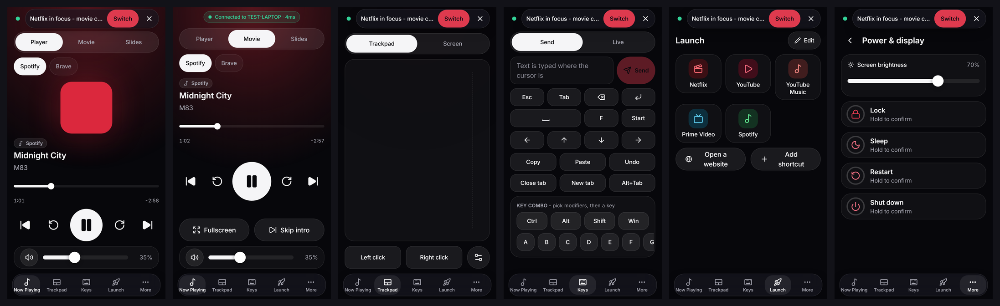
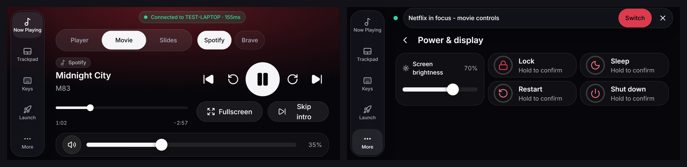

# LapRemote

Turn your phone into a fast, good-looking control panel for your laptop: universal media control,
a gesture trackpad, live screen preview, context-aware controls and natural-language commands. It
runs entirely on your local Wi-Fi. No cloud, no accounts, 100% free and open source.

- **Now Playing** for whatever is playing (Spotify, YouTube, Netflix in a browser...): artwork,
  scrubbing, per-player controls, and Movie, Music and Slides layouts that switch on their own.
- **Trackpad** with real gestures: tap, drag, two-finger scroll and right click, pinch zoom,
  three-finger swipes. Plus a **live screen preview** you can tap to click.
- **Keys** (live typing, shortcuts, combos), a **launcher** for sites and apps, **scenes**
  ("Movie Night"), a **sleep timer** with volume fade, brightness, and **power** with
  hold-to-confirm.
- **Ask LapRemote**: "pause everything", "next episode and volume 30". A local AI model
  (Ollama) turns it into the same safe actions the buttons send.
- **Send to laptop and back**: text, links, photos and files to the laptop; the laptop's
  clipboard to the phone.
- **Call buttons** for Zoom, Teams and Meet, and your own **button layouts** per app.
- **Lock-screen controls**, **several laptops** with a switcher and **Wake-on-LAN**, real
  shortcut icons, and a **light mode** (dark is the default).
- **Air mouse** and **voice input** when you turn on HTTPS.
- A **tray icon** and a **desktop dashboard** on the laptop for pairing, devices and settings.

Works today on Windows 11 (tested). macOS and Linux code paths exist but are untested; see the
[platform matrix](docs/PLATFORM_MATRIX.md).





<sub>Screenshots from the automated test run (scripted laptop data). Every screen fits without
scrolling on small and large phones, tablets and phones held sideways.</sub>

## How it works

```
 Phone (browser or installed PWA)                 Laptop
 React 19 + TypeScript  --- WebSocket (LAN) --->  Python agent (FastAPI)
 Now Playing, trackpad,                            input (pynput), media sessions,
 keys, launcher, AI ...   <-- state, preview ---   volume, screen preview, power,
                                                   tray + local dashboard, AI planner
```

- The phone app is served by the agent itself; nothing is installed on the phone.
- Pairing uses a one-time code; every message after that needs a per-device token.
- Every action comes from a fixed allowlist. Nothing a phone (or the AI) sends can run a command.
- Protocol, threat model and design are in [docs/](docs/).

## Install

You need [uv](https://docs.astral.sh/uv/), Python 3.12 and [Node.js](https://nodejs.org/) 22
or newer (Node only to build the phone app once). On Windows, install Python 3.12 from
[python.org](https://www.python.org/downloads/) (or `winget install Python.Python.3.12`): it is
code-signed, so Smart App Control lets it run. uv uses it automatically.

```bash
git clone https://github.com/samuelalex3737/lapremote.git && cd lapremote
cd agent && uv sync && cd ..
uv run --project agent python scripts/build_web.py
```

Or build a standalone app folder you can copy anywhere (`agent/dist/LapRemote/`):

```bash
uv run --project agent python scripts/build_agent.py
```

## Run and pair

```bash
cd agent && uv run python -m lapremote
```

(or run `LapRemote.exe` from the built folder)

1. A LapRemote icon appears in the system tray. The first time, the dashboard opens in your
   browser with a QR code and a short guide.
2. On your phone (same Wi-Fi), scan the QR code with the camera. The remote opens and pairs.
   The first phone becomes the **owner**; later phones are **guests** (media and volume only).
3. On the phone, use Share, then **Add to Home Screen** for an app icon.
4. If Windows asks about the firewall, allow **Private networks** only.

The tray menu has Pair a phone, Devices, Pause remote control, Open dashboard, Start at login,
Open logs folder and Quit. The dashboard is at http://127.0.0.1:7777/desktop and only opens on
the laptop itself.

Options: `--port 7790`, `--https`, `--no-tray` (no icon; the QR code prints in the terminal),
`--input-dry-run` (log input instead of moving the real mouse).

## HTTPS (optional)

Voice input and the air mouse need a secure page. Two free ways: **mkcert** (same Wi-Fi) or
**Tailscale Serve** (works away from home too). Step by step: [docs/HTTPS.md](docs/HTTPS.md).

## AI assistant (optional)

Install [Ollama](https://ollama.com), then pull a model that fits your memory: `qwen2.5:7b` with
16 GB of RAM or more, otherwise `qwen2.5:3b`. Check your setup:

```bash
uv run --project agent python scripts/ai_smoke.py check
```

Groq and Gemini free tiers also work with a key in an environment variable. Details and privacy
notes: [docs/AI.md](docs/AI.md).

## Troubleshooting

| Problem | Fix |
|---|---|
| The phone can't connect | Same Wi-Fi on both? Allow LapRemote (or Python) on **Private networks** in Windows Security > Firewall. Some guest or office networks block devices from seeing each other. |
| "port 7777 is already in use" | LapRemote is probably already running (check the tray). Or start with `--port 7790`. |
| The phone asks to pair again | The laptop's Wi-Fi address changed (another network, or the router gave it a new one), and the browser keeps pairings per address. LapRemote opens the dashboard with the new code by itself. The phone joins as a guest: in Devices, use Make owner on it and Remove its old entry. |
| The QR code doesn't work | The code changes every 5 minutes and works once. Use New code in the dashboard, or type the 6 digits on the pairing screen. |
| A phone shows "Remote control is paused" | Untick Pause remote control in the tray or dashboard. |
| The mouse doesn't move (macOS) | Give the terminal or LapRemote Accessibility permission in System Settings > Privacy & Security. |
| The mouse doesn't move (Linux) | Wayland blocks input injection. Log in to an X11 session. |
| Nothing shows in Now Playing (macOS / Linux) | Install `media-control` (macOS, `brew install media-control`) or `playerctl` (Linux). |
| Ask LapRemote says Ollama isn't running | Start Ollama, run `ollama pull <model>`, then reopen the app on the phone. |
| AI answers are slow | A 7B model on a laptop CPU takes about 10 to 20 seconds. Try `qwen2.5:3b` or Groq. |
| No mic button or air mouse | Those need HTTPS: see docs/HTTPS.md. |
| A Microsoft Store app (Spotify, WhatsApp...) won't open | Edit the shortcut and use "Pick from the laptop's apps". Store apps can't be started from their .exe. |
| Wake does nothing | Turn on Wake-on-LAN in the sleeping laptop's BIOS/UEFI and network adapter settings. Many laptops only wake over a network cable, not Wi-Fi. |
| No lock-screen controls | Settings > Controls on the lock screen, then tap anywhere once (browsers only allow sound after a tap) and start something on the laptop. |
| "An Application Control policy has blocked this file" | Windows Smart App Control is blocking an unsigned Python build. Install Python 3.12 from python.org, delete `agent/.venv`, and run `uv sync` again. |
| `config.json` is broken | LapRemote stops and says so. Fix the file or delete it to get the defaults back. |
| Logs | Tray > Open logs folder, or `~/.lapremote/logs/agent.log` (typed text and tokens are never logged). |

## Develop

```bash
cd agent && uv sync && cd ..
cd web && npm install && npx playwright install chromium webkit && cd ..
uv run --project agent python scripts/dev.py      # agent + Vite with reload, open http://localhost:5173
uv run --project agent python scripts/check.py    # every linter, type check and test
```

More tools: `scripts/recon.py` (machine report), `scripts/measure.py` (latency, input rate,
preview bandwidth, idle CPU), `scripts/ai_smoke.py` (AI planner without running actions),
`web/tests/accuracy/tapAccuracy.ts` (tap-to-click accuracy), `npm run lighthouse`. See
[docs/TESTING.md](docs/TESTING.md).

## Docs

- [Architecture](docs/ARCHITECTURE.md)
- [Protocol](docs/PROTOCOL.md)
- [Security and threat model](docs/SECURITY.md)
- [Platform matrix](docs/PLATFORM_MATRIX.md)
- [Testing](docs/TESTING.md)
- [AI assistant](docs/AI.md)
- [HTTPS](docs/HTTPS.md)
- [Demo script](docs/DEMO_SCRIPT.md)
- [Changelog](CHANGELOG.md)

## Roadmap

- Test and polish macOS and Linux (they are implemented but have not been run).
- Push feature changes to connected phones (`features.state`), so the AI screen notices Ollama
  starting without reconnecting. Proposed, waiting for approval.
- Show the phone's network round trip in the desktop dashboard. Proposed, waiting for approval.
- Drag to reorder shortcuts.
- Optional signed installers.

## License

[MIT](LICENSE)
