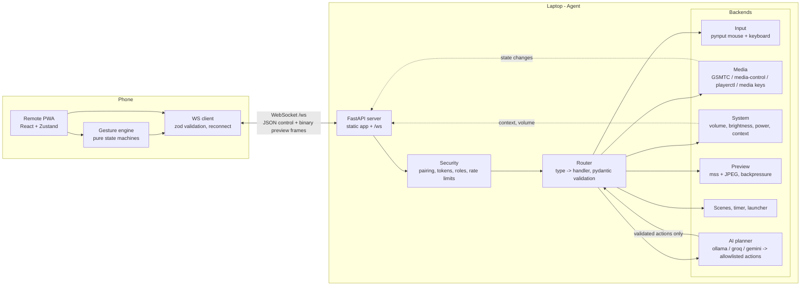
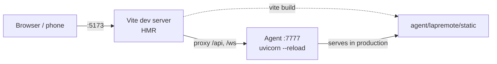

# LapRemote architecture

LapRemote has two parts that talk over the local Wi-Fi, with no internet and no cloud:

- **Agent** - a Python 3.12 process on the laptop (FastAPI + uvicorn). It serves the Remote web app,
  holds the single `/ws` WebSocket, and drives the OS (input, media, volume, screen capture).
- **Remote** - a React 19 + TypeScript PWA, served by the Agent and opened on the phone by scanning
  a QR code. It renders the control surfaces and sends allowlisted messages.

## Runtime view

### Request path

1. The phone sends a JSON envelope `{v, id, type, payload}` (see [PROTOCOL.md](PROTOCOL.md)).
2. **Security** rejects anything before `auth.pair` / `auth.resume`, checks the `Origin` header and
   applies rate limits.
3. The **Router** looks up the handler for `type`, enforces the role table, validates the payload
   with the pydantic model from `protocol.py`, and calls the backend. Bad input gets
   `ack ok:false`, never a closed socket.
4. Backends push state (`media.state`, `context.state`, `volume.state`, `timer.state`) back to every
   connected device as it changes.

### Security boundaries

- Every action comes from a fixed allowlist in `protocol.py`. No message runs a shell command or an
  arbitrary path.
- The AI layer can only produce actions from the same allowlist. Its output is validated like any
  other client message before it reaches the router.
- Device tokens are stored as SHA-256 hashes in `~/.lapremote/devices.json`.

## Development view

- `scripts/dev.py` starts both processes and stops both on Ctrl+C.
- In production the Agent serves the built app from `agent/lapremote/static/` (git-ignored, built
  by `vite build`), so the phone only ever talks to one host and port.

## Code layout

| Path | Purpose |
|---|---|
| `agent/lapremote/` | Agent package (`python -m lapremote`) |
| `agent/lapremote/config.py` | `~/.lapremote/config.json` load/save with validated defaults |
| `agent/lapremote/server.py` | FastAPI app: `/ws`, static Remote app, `/api/health`, Origin check, auth timeout |
| `agent/lapremote/protocol.py` | Every message model, roles, reply rules, schema export |
| `agent/lapremote/router.py` | Envelope parsing, auth and role checks, validation, rate limits, dispatch, command log |
| `agent/lapremote/core.py` | Agent state and core handlers (auth, ping, devices) |
| `agent/lapremote/connection.py` | One phone connection and the hub of all connections |
| `agent/lapremote/security/` | Pairing codes, device store (token hashes), rate limiters |
| `agent/lapremote/discovery.py` | mDNS advertisement |
| `agent/lapremote/banner.py` | Terminal QR banner |
| `agent/lapremote/logging_setup.py` | JSON-lines log with rotation |
| `agent/lapremote/system/platform_info.py` | OS detection and external tool checks |
| `agent/lapremote/system/network.py` | LAN IP selection |
| `agent/lapremote/system/{dpi,permissions,context,volume,brightness,power}.py` | DPI awareness, input permission checks, foreground app and site, volume, brightness, power actions |
| `agent/lapremote/input/` | Mouse and keyboard (pynput), dry-run backend, absolute click mapping, input handlers |
| `agent/lapremote/media/` | Media sessions per OS (GSMTC, media-control, playerctl), media keys fallback, smart seek, `media.state` push |
| `agent/lapremote/preview/` | Screen capture (mss), JPEG frames with flow control, calibration page |
| `agent/lapremote/shortcuts.py`, `scenes.py`, `timer.py` | Launcher, scenes, sleep timer |
| `agent/lapremote/actions.py` | One facade for actions run by scenes, the timer and the AI |
| `agent/lapremote/ai/` | Chat providers (Ollama, Groq, Gemini), the planner (prompt, validation, retry) and the AI service (plan, confirm, run) |
| `agent/lapremote/desktop.py`, `desktop_page.py`, `assets/dashboard.html` | Localhost-only `/desktop` dashboard and its JSON API |
| `agent/lapremote/tray.py` | Tray icon and menu (pystray); tray mode runs the server in a thread |
| `agent/lapremote/autostart.py` | Start at login on Windows, macOS and Linux |
| `agent/packaging/entry.py` | Entry point for the PyInstaller build (`scripts/build_agent.py`) |
| `agent/lapremote/services.py` | Builds every feature service; tests inject fakes through `Overrides` |
| `agent/lapremote/storage.py` | Atomic JSON files seeded from `shared/*.default.json` |
| `shared/protocol.schema.json` | Normalised protocol schema both sides are tested against |
| `agent/tests/` | pytest suite |
| `web/src/app/` | App shell |
| `web/src/lib/` | Pure logic: `protocol.ts` (zod mirror), `ws.ts` (connection client), gestures, media, adaptive modes, preview, keys, timer, shortcuts, AI labels and suggestions, air mouse maths |
| `web/src/store/` | Zustand stores: connection and laptop state, UI, AI conversation |
| `web/src/ui/` | Design system: buttons, sheets, sliders, toasts, primitives |
| `web/src/features/` | Screens: pairing, Now Playing, trackpad and air mouse, screen preview, keys, launcher, scenes, timer, power, AI, devices, settings, HTTPS help |
| `web/tests/unit/` | vitest |
| `web/tests/e2e/` | Playwright mobile smoke tests (iPhone 15, Pixel 8) |
| `scripts/` | `dev.py`, `check.py`, `recon.py`, `build_web.py`, `make_icons.py`, `measure.py`, `ai_smoke.py`, `build_agent.py` |
| `docs/` | Architecture, protocol, platform matrix, testing, security, AI, HTTPS, phase reports |

Modules listed in the build spec are added in the phase that implements them. Nothing is created
empty ahead of time.

## Runtime data

Everything the Agent writes lives in `~/.lapremote/` (override with `LAPREMOTE_HOME`):

| File | Phase |
|---|---|
| `config.json` | 0 |
| `devices.json` | 1 |
| `logs/agent.log` (rotating, 5 x 1MB) | 1 |
| `shortcuts.json`, `scenes.json` | 7 |
